<div align="center">

# 🔷 BIFlow

### From raw files to an explained BI dashboard — automatically

*A multi-agent system that prepares, models, analyses and explains any dataset,<br/>with a local LLM whose every decision is verified by code.*


-6E40C9)


**Team Nexora** · Chiheb Mejri & Molka Jerbi · Advanced Data Science Project — ESPRIT

[Quick start](#quick-start) · [Architecture](#architecture) · [Notebook](#notebook) · [Installation](#installation) · [Execution](#execution) · [Results](#results)

</div>

---

## ✨ What BIFlow does

Give BIFlow **any dataset** — CSV, TSV, Excel, Parquet or JSON, one table or several — and it delivers, **with no code to write and no human validation**:

| | Deliverable | What you get |
|:-:|---|---|
| 🧹 | **Clean, traced data** | Typed and cleaned tables; every changed cell logged *before → after*; estimated values flagged |
| ⭐ | **Star-schema warehouse** | Facts and dimensions designed automatically in DuckDB, every table tested and reconciled with the source |
| 📊 | **KPI catalog** | Sector KPIs retrieved by semantic search, compiled to SQL and computed twice (SQL + pandas) |
| 💡 | **Verified insights** | Trends, anomalies and segment gaps written by the LLM, every number checked against the facts |
| 🖥️ | **Interactive dashboard** | A self-contained `dashboard.html`, laid out by the LLM following BI best practices |
| 💬 | **Explainability chat** | Ask *"why did BIFlow do that?"* about any decision — with evidence, author and counterfactual |

> **Core principle — the LLM decides, the code verifies, everything is traced.**
> No LLM decision is applied without a deterministic supervisor validating it. A rejected decision is sent back with the reason
> so the LLM can correct itself; if it still fails, a cautious fallback takes over. **The pipeline never depends entirely on the LLM.**

---

<a id="table-of-contents"></a>
## 📑 Table of contents

| | | |
|---|---|---|
| 1. [Problem statement](#problem) | 6. [Installation](#installation) | 11. [Limitations](#limitations) |
| 2. [Architecture](#architecture) | 7. [Execution](#execution) | 12. [Data, ethics & confidentiality](#ethics) |
| 3. [The notebook, step by step](#notebook) | 8. [Outputs](#outputs) | 13. [Use of generative AI](#genai) |
| 4. [Repository organization](#repository) | 9. [Reproducibility](#reproducibility) | |
| 5. [Requirements](#requirements) | 10. [Results](#results) | |

---

<a id="quick-start"></a>
## 🚀 Quick start

```powershell
git clone https://github.com/molkajerbi/BIFlow-Nexora-team.git
cd BIFlow-Nexora-team
py -3.11 -m venv .venv; .\.venv\Scripts\Activate.ps1; pip install -r requirements.txt
ollama pull qwen2.5:7b
cd web; npm install; cd ..
.\lancer.ps1          # opens http://localhost:3000
```

Then: **create an account → New analysis → upload your files → explore the results.** Full details in [Installation](#installation).

---

<a id="problem"></a>
## 🎯 1. Problem statement

Building a BI dashboard usually takes days of manual work: understanding the files, cleaning them, designing a data warehouse,
choosing and computing KPIs, analysing trends, building the dashboard, and documenting every choice.
Each step is **slow**, **error-prone** (wrong joins, double counting, invented values) and **hard to audit**.

**Goal:** automate this whole chain end to end, for *any* dataset, while keeping it

| 🛡️ Reliable | 🔍 Traceable | 🗣️ Explainable |
|---|---|---|
| Every result is tested | Every action is logged | Every decision can be justified in plain language |

**Main challenges addressed**

- **Genericity** — no line of code is written for a specific dataset; structure, quality rules and KPIs are inferred or learned from the data.
- **LLM reliability** — a small local LLM can hallucinate; every LLM decision is checked by a deterministic supervisor.
- **Correct BI numbers** — avoiding the double-counting trap (fan-out) and reconciling every amount with the source.
- **Auditability** — a tamper-evident audit log, row-level lineage and a decision ledger.

---

<a id="architecture"></a>
## 🏗️ 2. Architecture

```mermaid
flowchart LR
    A[(📁 Raw files)] --> S1

    subgraph P1["🧹 Part 1 · Data Preparation Agent"]
        direction TB
        S1["1 · Contract & ingestion<br/><b>BRONZE</b>"] --> S2["2 · Profiler tools"]
        S2 --> S3["3 · Domain + Profiler agents<br/>🤖 LLM"]
        S3 --> S4["4 · Quality & Cleaning agent<br/><b>SILVER</b>"]
        S4 --> S5["5 · ETL agent<br/><b>GOLD</b> · star schema"]
    end

    subgraph P2["📊 Part 2 · BI & Insight Agent"]
        direction TB
        S7["7 · KPI knowledge base<br/>RAG"] --> S8["8 · KPI agent"]
        S8 --> S9["9 · Analyst agent"]
        S9 --> S10["10 · Dashboard agent"]
    end

    subgraph P3["💬 Part 3 · Explainability"]
        direction TB
        S12["12 · XAI agent<br/>chat"]
    end

    S5 --> S7
    S10 --> S12
    S12 --> D[["🖥️ Dashboard<br/>+ explanations"]]

    classDef bronze fill:#f3e2cf,stroke:#b07a43,color:#3b2a1a
    classDef silver fill:#e8ebef,stroke:#8a96a3,color:#1f2933
    classDef gold fill:#fff1c2,stroke:#c9a227,color:#3b3000
    classDef llm fill:#ece6ff,stroke:#6e40c9,color:#25125a
    class S1 bronze
    class S4 silver
    class S5 gold
    class S3,S8,S9,S10,S12 llm
```



<sub>Steps 6, 11 and 13 are the orchestrators: they chain the agents of part 1, of part 2, and of the whole system.</sub>

| Concept | How BIFlow applies it |
|---|---|
| 🥉🥈🥇 **Medallion architecture** | *Bronze* (raw, immutable) → *Silver* (typed, cleaned) → *Gold* (star schema, KPIs) |
| 🔀 **Orchestration** | Each part is a **LangGraph state graph** (steps 6 and 11), chained by a global graph (step 13). After each node, a conditional edge decides: *continue* or *stop cleanly* (`blocked`, `failed`) |
| 🚦 **Quality gates** | A step only runs if the previous one passed its checkpoint — e.g. a blocking quality issue forbids the ETL |
| 🤝 **Supervised agents** | Closed catalogs of actions, consistency checks, anti-hallucination checks, feedback & retries, fallback |

---

<a id="notebook"></a>
## 📓 3. The notebook, step by step

The whole pipeline is **one notebook of 13 steps**. Every step ends with a ✅ **checkpoint**: raw data unchanged, audit chain intact, step-specific tests.

### 🧹 Part 1 · Data Preparation Agent — steps 1 to 6

| Step | What it does | Key techniques |
|---|---|---|
| **1** · Foundations & ingestion | Frozen configuration · **tamper-evident audit log** · **automatic data contract inference** (encoding, separator, semantic types, date formats, grain, relationships, fact/dimension roles, confidence score) · traceable ingestion into the **bronze** zone with row-level **lineage** | SHA-256 hash chain · inclusion dependencies · smallest unique key (1–3 columns) · immutable store with fingerprints |
| **2** · Profiler tools | 5 audited, deterministic tools: column profile · grain & duplicates · relationships (orphans, undeclared links) · **explained missing values** · **anomaly detection** · health map and findings | `@audited` decorator · closed tool registry · Cramér's V · Jaccard · IQR · MAD robust z-score · Isolation Forest |
| **3** · LLM agents | **Domain & Contract Agent** (business domain, contract review through a closed catalog of corrections) · **Profiler Agent**: screening → **LLM-driven investigation (tool calling)** → findings by **DAMA dimension** → **business interpretation** | ReAct-like loop · supervisor validation · feedback & retries · anti-hallucination check on numbers · fallback · autonomy rate |
| **4** · Quality & Cleaning Agent | Typing (**silver**) · policy for missing / impossible / extreme values · **DAMA rule engine** (rules from the contract + **business rules learned from the data**) · fixes **simulated in a sandbox** · LLM decides *propose / dismiss* · **automatic risk policy** · controlled application · re-validation and quality report | Group median (η²) · Cramér's V · log-scale IQR per group · rule mining (≥ 99 % / ≥ 95 %) · side-effect check by hashing · quality gate `blocked` / `ready_with_warnings` / `ready` |
| **5** · ETL Agent | SQL warehouse · staging with date keys, generated calendar, **time indicators discovered from the data** · **automatic star-schema design** ("unknown" members, dimensions extracted by functional dependencies, **separate aggregates against double counting**) · LLM chooses the build order · every table tested · **fan-out demonstration** | DuckDB (SQLite fallback) · Kimball conventions · topological sort · tests: unique grain, row count, lineage, **sum reconciliation**, foreign keys |
| **6** · Sub-orchestrator | Agents become nodes of a graph · single entry point `run_data_preparation()` | LangGraph (built-in mini engine as fallback) · shared state · conditional edges |

### 📊 Part 2 · BI & Insight Agent — steps 7 to 11

| Step | What it does | Key techniques |
|---|---|---|
| **7** · Knowledge base | Hand-over from part 1 · inventory of what can be computed · **KPI knowledge base** per sector · **semantic search (RAG)** · KPI feasibility · business sector (search proposes, LLM decides, code verifies) | Embeddings `intfloat/multilingual-e5-small` + TF-IDF (lexical fallback) |
| **8** · KPI Agent | **Compiler from a closed KPI language to SQL** (and to pandas for an independent second computation) · KPI-to-column binding (automatic, LLM when ambiguous) · tests · KPIs proposed by the agent · KPI catalog | Closed DSL · double computation SQL / pandas · plausibility bounds by unit |
| **9** · Analyst Agent | Reliable monthly series · statistical change detection · breakdown by segment · LLM-driven investigation · **verified insights** (every number and direction of change checked) | Statistical tests · segment analysis · anti-hallucination checks |
| **10** · Dashboard Agent | Dashboard candidates · layout chosen by the LLM, best practices enforced by the supervisor · self-contained `dashboard.html` | HTML/JS template · offline rendering |
| **11** · Sub-orchestrator | `run_bi_insight()` · steps registry · restart from a step · **reproducibility diagnostic** | LangGraph |

### 💬 Part 3 · Explainability & global orchestration — steps 12 and 13

| Step | What it does | Key techniques |
|---|---|---|
| **12** · XAI Agent | **Decision ledger** (every decision of steps 1–11 with reason, evidence, author, audit link) · rules read from the code · explanation search · answer built by the rules, rephrased by the LLM, verified by the code · **chat** · evaluation (coverage, retrievability, faithfulness) | Traceability · local & global explanations · counterfactuals |
| **13** · Global orchestrator | `run_biflow()`: input check → Data Preparation → BI & Insight → XAI → delivery, in **one command** · comparison with the cell-by-cell run · final checkpoint · chat on the full run | Global LangGraph graph · explainability always built, even after a stop |

---

<a id="repository"></a>
## 🗂️ 4. Repository organization

| Branch | Content |
|---|---|
| 🌐 `deploiement-web` · **default** | **Deployed application** — FastAPI back end + Next.js web application |
| 📓 `notebook-complet-bi-xai` | **Final notebook, full pipeline (parts 1, 2 and 3)** — `biflowenglish.ipynb` |
| 🧹 `data-preparation-agent-notebook` | Data Preparation Agent notebook (part 1) |
| 🧪 `deployment` | First deployment — Streamlit interface |

<details>
<summary><b>📁 Structure of the deployed application</b> (click to expand)</summary>

```text
BIFlow-Nexora-team/
├── notebooks/
│   └── biflowenglisch.ipynb    # the notebook executed by the application (source of truth)
├── biflow/                     # pipeline engine
│   ├── __main__.py             # command line: extract | check | run
│   ├── extract.py              # notebook → biflow/steps/ (one file per cell, never modified by hand)
│   ├── engine.py               # runs the notebook cells in order = global orchestrator (step 13)
│   ├── llm.py                  # OllamaLLM client (local LLM, no API key)
│   ├── jobs.py                 # analyses: creation, launch, progress, results
│   ├── xai_chat.py             # explainability chat on a finished analysis
│   └── steps/                  # generated cells + manifest.json
├── api/                        # FastAPI back end
│   ├── main.py                 # REST API (accounts, analyses, results, dashboard, chat, notifications)
│   ├── auth.py                 # local accounts (SQLite, PBKDF2 hashing), sessions, optional Google sign-in
│   └── notify.py               # notifications (in app, desktop, optional email)
├── web/                        # Next.js 15 / React 19 front end
│   ├── app/                    # pages: home, sign in, sign up, analyses, new analysis, profile
│   ├── components/             # interface components (charts, chat, notifications…)
│   └── lib/                    # API calls, formatting, session
├── app.py                      # Streamlit interface (alternative)
├── lancer.ps1                  # Windows: starts the API and the web application
├── requirements.txt            # Python dependencies
├── .env.exemple                # optional settings (Google sign-in, email) — copy to .env
└── .gitignore                  # data/, jobs/, .env, accounts database, node_modules… are not versioned
```

Generated at run time and **not versioned**: `data/`, `jobs/`, `biflow_cache/`, `biflow_accounts.sqlite3`, `.env`.

</details>

---

<a id="requirements"></a>
## 🧰 5. Requirements

| | 📓 Notebook (Kaggle) | 🌐 Deployed application (local) |
|---|---|---|
| **Python** | Kaggle environment | **3.11** |
| **GPU** | **T4 × 2** for Qwen 2.5 7B (one T4: use the 3B model) | Not required — Ollama runs on CPU, uses a GPU if available |
| **LLM** | `Qwen/Qwen2.5-7B-Instruct` via `transformers` | [Ollama](https://ollama.com) with `qwen2.5:7b` (≈ 4.7 GB) |
| **Node.js** | — | **20 LTS** (≥ 18.18) |
| **RAM** | Kaggle default | 16 GB recommended (8 GB with `qwen2.5:3b`) |
| **Internet** | Once (model download) | Once (dependencies, model) — analyses then run offline |

---

<a id="installation"></a>
## ⚙️ 6. Installation

### 📓 6.1 Notebook (Kaggle)

1. Import `biflowenglish.ipynb` (branch `notebook-complet-bi-xai`) into Kaggle.
2. **Settings → Accelerator → GPU T4 × 2**, and **Internet: on**.
3. **Add Input → attach exactly ONE dataset.** The notebook finds it automatically and stops if there are zero or several.

`torch`, `transformers`, `pandas` and `scikit-learn` are preinstalled on Kaggle; `duckdb`, `langgraph` and `sentence-transformers` are imported or installed by the notebook itself.

> 💡 **Locally** (NVIDIA GPU): put the dataset in `./data/` or set `BIFLOW_DATA_DIR`, then
> `pip install -r requirements.txt torch transformers accelerate jupyter`.

### 🌐 6.2 Deployed application (Windows, PowerShell)

```powershell
# 1 · Get the code (deploiement-web is the default branch)
git clone https://github.com/molkajerbi/BIFlow-Nexora-team.git
cd BIFlow-Nexora-team

# 2 · Python environment
py -3.11 -m venv .venv
.\.venv\Scripts\Activate.ps1
pip install -r requirements.txt

# 3 · Local LLM — install Ollama first: https://ollama.com/download
ollama pull qwen2.5:7b
python -m biflow check          # expected: "OK : qwen2.5:7b disponible …"

# 4 · Web application
cd web
npm install
cd ..
```

🐧 **macOS / Linux:** same steps with `python3.11 -m venv .venv` and `source .venv/bin/activate`.

<details>
<summary><b>🔧 6.3 Optional settings (<code>.env</code>)</b> (click to expand)</summary>

Without `.env`, BIFlow works normally (email + password accounts, notifications in the app).
To enable **Google sign-in** or **email notifications**, copy `.env.exemple` to `.env` and fill in the fields
(`BIFLOW_GOOGLE_CLIENT_ID`, `BIFLOW_SMTP_*`). The `.env` file holds private settings and is never committed.

| Variable | Default | Role |
|---|---|---|
| `BIFLOW_LLM_MODEL` | `qwen2.5:7b` | Ollama model |
| `OLLAMA_URL` | `http://localhost:11434` | Ollama address |
| `BIFLOW_EMBED_MODEL` | `intfloat/multilingual-e5-small` | Embedding model for the RAG (lexical fallback if unavailable) |
| `BIFLOW_DATA_DIR` | — | Notebook only: dataset folder |

</details>

---

<a id="execution"></a>
## ▶️ 7. Execution

### 📓 Notebook
Click **Run All** — nothing to configure. The dataset is found automatically, the pipeline runs 100 % automatically, and every step prints its checkpoint (`STEP n PASSED`).
The last steps run everything again in one command (`run_biflow()`) and open the XAI chat:

```python
ask("Why was the median used for this column?")
```

### ⌨️ Command line

```powershell
python -m biflow check                              # is Ollama ready?
python -m biflow run data\my_dataset                # full pipeline A → Z on a folder with ONE dataset
python -m biflow run data\my_dataset --model qwen2.5:3b
python -m biflow extract                            # re-extract the cells after changing the notebook
```

Results: `jobs/<date>/result.json` and the deliverables folder.

### 🌐 Web application

Make sure **Ollama is running**, then from the project root:

```powershell
.\lancer.ps1
```

This starts the **API** on http://localhost:8000 and opens the **web application** on http://localhost:3000.

<details>
<summary>Or start them manually, in two terminals</summary>

```powershell
# terminal 1 — API
.\.venv\Scripts\Activate.ps1
uvicorn api.main:app --port 8000

# terminal 2 — web application
cd web
npm run dev
```

</details>

**🎬 Demo flow**

```text
Create an account ─► New analysis ─► Upload files (or a ZIP) ─► Follow the live progress
   ─► Explore: data preparation · quality before/after · star schema · KPIs · insights · dashboard
   ─► Ask "why?" in the XAI chat ─► Download the deliverables
```

A notification (in the app, on the desktop, and optionally by email) tells you when the analysis is finished.

### 🧪 Streamlit interface (branch `deployment`)

```powershell
streamlit run app.py
```

---

<a id="outputs"></a>
## 📦 8. Outputs

Each run writes to its own folder — `biflow_runs/<RUN_ID>/` in the notebook, `jobs/<id>/` in the application. **A run never overwrites another.**

| Path | Content |
|---|---|
| 🔒 `audit_log.jsonl` | Tamper-evident audit log (hash chain) of every action and decision |
| 📜 `data_contract.json` | Inferred data contract (types, grain, relationships, roles, confidence) |
| 🔬 `profiling/` | Tool results, health map, findings, profiling report, Profiler agent trace |
| 🧹 `quality/` | Typing report, rules before/after, cleaning plan, every changed cell (before → after), removed rows, DAMA scores |
| ⭐ `warehouse/` | `biflow_star.duckdb`, one CSV per table, ETL tests, ETL agent trace, `etl_manifest.json` |
| 📤 `data_preparation_output/` | Delivery of part 1 (cleaned data, star schema, reports, manifest) |
| 📊 `bi/` | KPI references, KPI catalog and monthly series, analysis, **verified insights**, `dashboard.html` |
| 💬 `xai/` | Decision ledger, system rules, XAI evaluation report |
| 🧾 `biflow_run_report.json` | Global run report and manifest of all deliverables |
| 🔀 `*.mmd` | Orchestration graphs (Mermaid) |

---

<a id="reproducibility"></a>
## 🔁 9. Reproducibility

| | Mechanism |
|---|---|
| 🎲 | **Fixed seed** (`random_seed = 42`) and **deterministic LLM decoding** (greedy, `do_sample=False`) |
| 🧊 | **Frozen configuration** (`@dataclass(frozen=True)`), unique `RUN_ID` per run, output folders never overwritten |
| ✅ | **Integrity checks** at every checkpoint: raw data fingerprint unchanged, audit hash chain verified, row counts explained |
| 🔑 | **SHA-256 fingerprints** of the cleaning plan and of every generated SQL query, recorded in the audit log |
| 🔂 | **Reproducibility diagnostic** (steps 11.6 and 13.3): the one-command run is compared with the cell-by-cell run |
| 🔗 | The application **executes the notebook cells themselves** (`biflow/steps/` is generated by `python -m biflow extract`): notebook and application cannot drift apart |
| 📌 | Dependencies listed in `requirements.txt` |

---

<a id="results"></a>
## 📈 10. Results

**Main dataset — Olist, Brazilian E-Commerce Public Dataset:** 9 related tables (orders, items, payments, reviews, customers,
sellers, products, geolocation, category translation), ≈ 100 000 orders, 2016–2018.

To check **genericity and robustness**, the deployed application was also tested on **synthetic test datasets** built by the team:
a single flat table, an Excel workbook, a JSON file, a multi-table retail dataset, a geolocation table, and "hard" cases
(disguised empty values, spelling variants, duplicates, impossible and extreme values, orphan keys).

| | Result |
|---|---|
| 🧩 **Generic** | The same code builds the contract, quality rules, star schema and KPIs of each dataset — no dataset-specific line |
| 🧹 **Data quality** | DAMA scores measured before and after cleaning with the *same* rules; every change logged and reversible |
| 🧮 **Correct numbers** | Every warehouse table passes its tests (unique grain, exact row count, complete lineage, sums reconciled with the source). The fan-out demonstration shows a naive join overstating amounts, while BIFlow's separate aggregates match the ground truth |
| 🤖 **Controlled autonomy** | Autonomy rate, rejected decisions and fallbacks measured for every agent |
| 💬 **Explainability** | Every decision can be explained in the chat with its evidence, author and counterfactual |

📄 Detailed figures, experiments and analysis: see the **technical report**.

---

<a id="limitations"></a>
## ⚠️ 11. Limitations

- **Small local LLM (7B)** — limited reasoning on complex domains; mitigated by supervisors and fallbacks, but some business nuances may be missed.
- **Performance** — on CPU, a full analysis of a large dataset can take a long time (many LLM calls, e.g. KPI proposals).
- **Heuristic thresholds** (99 % rule support, 30 % imputation limit, 3 IQR…) — general defaults, not tuned per domain.
- **Conservative cleaning** — issues without a safe fix (orphan keys, probable duplicate entities) are flagged, not corrected.
- **Scope** — tabular data only (no free text, images or streaming); one dataset per analysis.
- **Deployment** — local, single-machine application (no multi-user server deployment or admin panel).

---

<a id="ethics"></a>
## 🔐 12. Data, ethics & confidentiality

- **Olist dataset** — public dataset published by Olist on [Kaggle](https://www.kaggle.com/datasets/olistbr/brazilian-ecommerce),
  license **CC BY-NC-SA 4.0** (non-commercial use, attribution, share-alike). The data is **anonymized** by the publisher
  (customers, sellers and orders identified by hashed IDs; company names in reviews replaced).
- **Synthetic test datasets** — generated by the team; no real personal data.
- **100 % local processing** — the LLM, the embeddings and the database run on the user's machine; no data is sent to an external API.
- **No silent change** — raw data is never modified (immutable bronze zone); estimated values are flagged; every change is traced.
- **Accounts** — passwords hashed with PBKDF2; Google sign-in only confirms the user's identity, no data is shared.

---

<a id="genai"></a>
## 🤖 13. Use of generative AI

In accordance with the module rules, we explicitly declare the use of generative AI tools in this project.

**1 · Inside the product.** BIFlow uses the open-source LLM **Qwen 2.5 7B Instruct** (Alibaba Cloud, Apache 2.0 license),
run locally, as the decision engine of its agents. Its decisions are always checked by deterministic supervisors ([section 2](#architecture)).

**2 · During development.** The team used **Claude (Anthropic)** as an AI assistant for:

- help writing and refactoring parts of the code, in particular the web deployment (FastAPI back end, Next.js interface,
  notifications, Google sign-in) and the engine that runs the notebook in the application;
- debugging and testing (error analysis, test scripts, end-to-end checks of the deployment);
- translating the notebook outputs and the interface into English;
- documentation (this README, code comments) and help preparing the presentation and the demo voice-over.

The problem framing, the architecture, the methodological choices, the experiments and the validation of the results
were decided, reviewed and checked by the team. Every piece of AI-assisted code was read, executed and tested by the team,
and both members can explain every part of the project.

---

<div align="center">

**BIFlow** · Team Nexora · ESPRIT · 2026

[⬆ Back to top](#table-of-contents)

</div>
